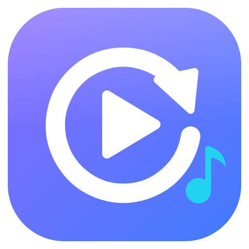
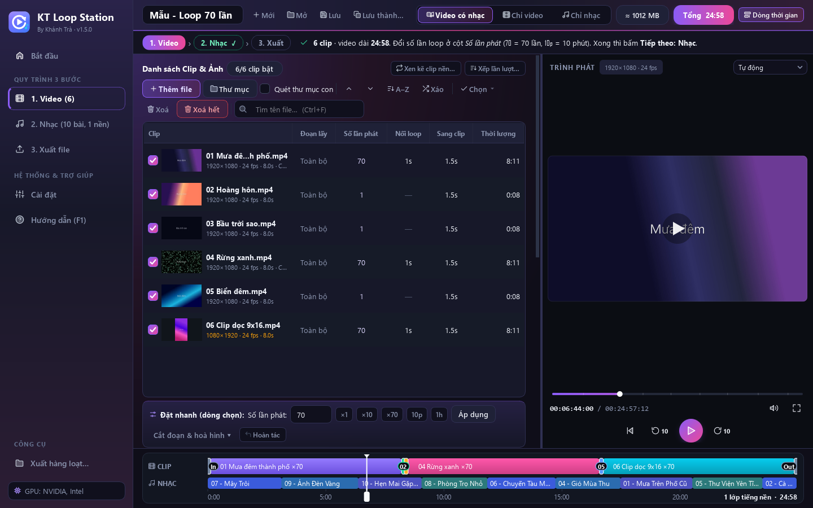
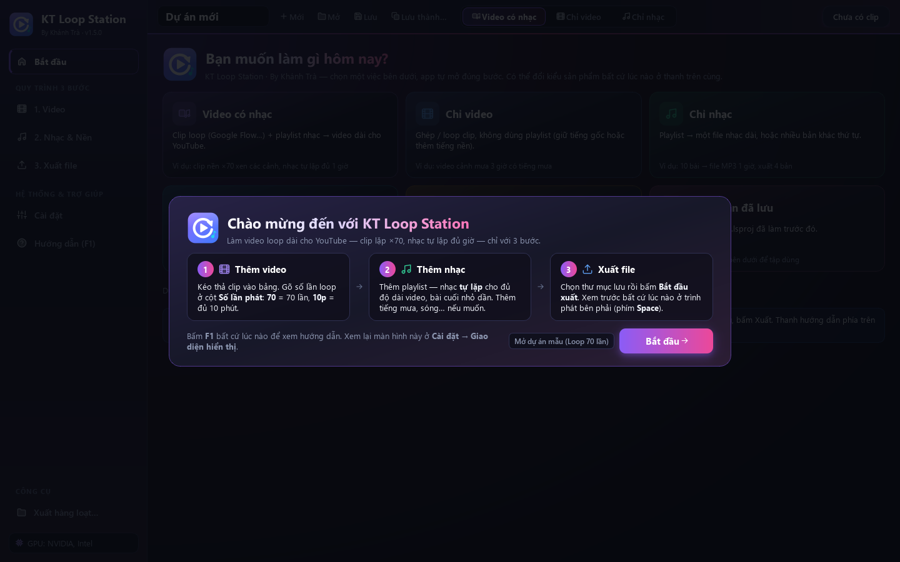
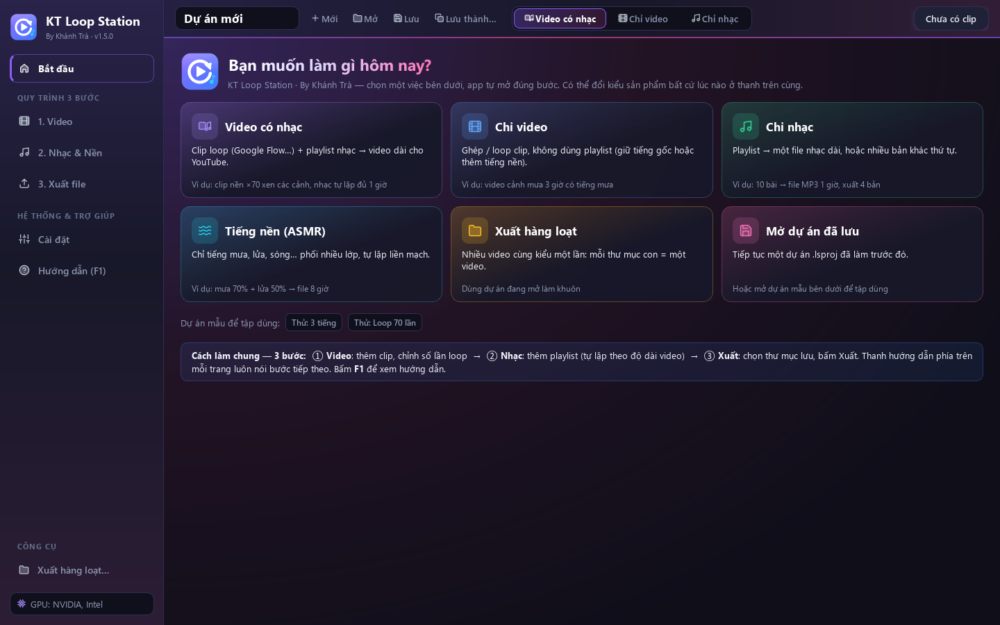
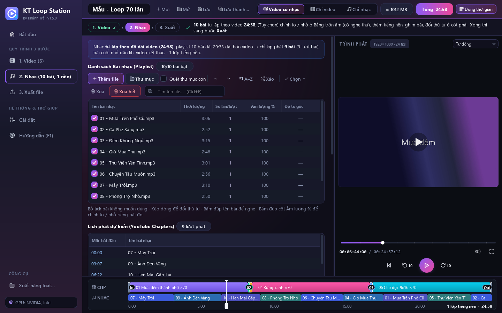
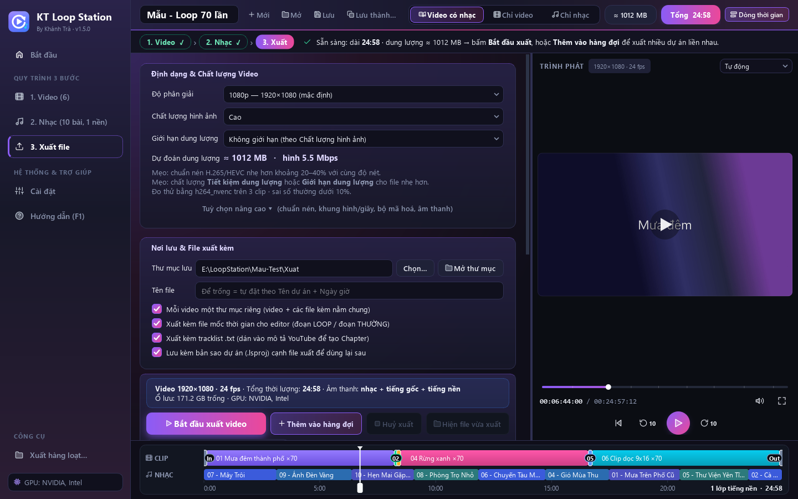
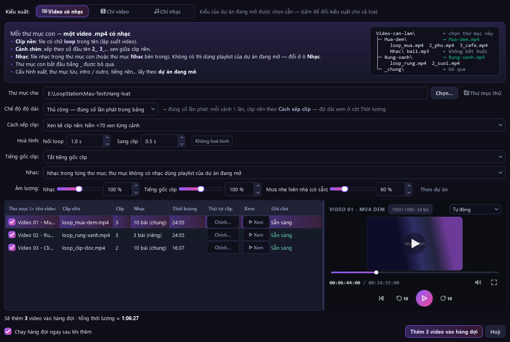
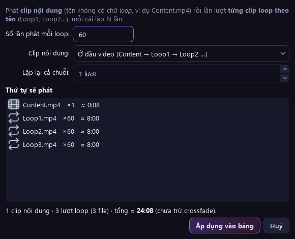

<div align="center">



# KT Loop Station

**Ghép và loop clip + nhạc thành video YouTube dài hàng giờ — xem trước ngay trong app, xuất nhanh bằng card đồ hoạ.**

<sub>By Khánh Trà · Ứng dụng Windows · Giao diện tiếng Việt</sub>

<br>

[](https://github.com/trakhanh/Auto-Loop/releases/latest)
[](https://github.com/trakhanh/Auto-Loop/releases)


<br>

<a href="https://github.com/trakhanh/Auto-Loop/releases/latest/download/KTLoopStation-Setup.exe">
  
</a>

<sub>Bấm nút để tải bộ cài · <a href="https://github.com/trakhanh/Auto-Loop/releases/latest/download/So-tay-KT-Loop-Station.html">Tải sổ tay hướng dẫn</a> · <a href="https://github.com/trakhanh/Auto-Loop/releases">Xem các phiên bản cũ</a></sub>

<br><br>



<sub>Trang đang làm bên trái · <b>Trình phát</b> bên phải · <b>dòng thời gian</b> ở đáy — bố cục giống CapCut / Premiere</sub>

</div>

<br>

## Có gì mới ở 1.6

<table>
<tr>
<td width="50%" valign="top">
<br>
<b>Màu sắc nổi bật, chọn được màu chủ đạo</b><br>
Giao diện mới <b>Neon tím hồng</b>: nền có quầng sáng, thanh bên / thanh trên cùng chuyển màu, mỗi thẻ ở màn hình Bắt đầu ánh một màu riêng. Thích tông khác? <i>Cài đặt → Giao diện hiển thị → Màu chủ đạo</i>: <b>Đại dương</b>, <b>Hoàng hôn</b>, <b>Tím xanh</b> (như bản cũ) — đổi là thấy ngay.
</td>
<td width="50%" valign="top">
<br>
<b>Hiệu ứng sống động</b><br>
Gợn sóng khi bấm nút, viền sáng ô đang gõ, nút <b>Bắt đầu xuất</b> phát sáng nhẹ khi đã sẵn sàng. Lúc đang xuất, vạch màu dưới thanh trên cùng chạy liên tục và thanh tiến trình có vệt sáng — ở trang nào cũng biết app đang làm việc.
</td>
</tr>
<tr>
<td valign="top">
<br>
<b>Mượt hơn</b><br>
Chuyển trang bằng ảnh chụp trang nên luôn trượt mượt, kể cả bảng clip dài nhiều ảnh thu nhỏ. Bộ chọn kiểu xuất có khối sáng trượt theo lựa chọn; hiệu ứng tự dừng khi không cần để máy không phải vẽ thừa.
</td>
<td valign="top">
<br>
<b>Màn hình chào lần đầu</b><br>
Mới cài app là có hướng dẫn 3 bước <i>Video → Nhạc → Xuất</i> và nút mở dự án mẫu để tập. Xem lại bất cứ lúc nào ở <i>Cài đặt → Giao diện hiển thị</i>.
</td>
</tr>
</table>

<p align="center"></p>

<details>
<summary><b>Có gì ở 1.5</b> (trình phát trong app, xếp lần lượt, xuất hàng loạt dễ hơn, chung bộ từ ngữ)</summary>

<br>

<table>
<tr>
<td width="50%" valign="top">
<br>
<b>Trình phát ngay trong app</b><br>
Xem thử video thành phẩm — hình, nhạc, tiếng gốc, tiếng nền, hoà hình, màu &amp; logo y như bản xuất — <b>không phải xuất file</b>. Kéo vạch trên dòng thời gian để tua, <kbd>Space</kbd> phát / dừng ở mọi chỗ, nhấp đúp để xem toàn màn hình. Sửa dự án là trình phát tự cập nhật.
</td>
<td width="50%" valign="top">
<br>
<b>Xếp lần lượt từng loop</b><br>
Thư mục có <code>Content.mp4</code> + <code>Loop1.mp4</code> … <code>Loop6.mp4</code>? Bấm <b>Xếp lần lượt…</b> → <i>Content → Loop1 ×60 → Loop2 ×60 → … → Loop6 ×60</i>. App tự gợi ý khi kéo thư mục vào, và xuất theo fps của các loop để hình không giật.
</td>
</tr>
<tr>
<td valign="top">
<br>
<b>Xuất hàng loạt dễ hơn</b><br>
3 nút kiểu xuất ngay trong hộp thoại (Video có nhạc · Chỉ video · Chỉ nhạc), khung ghi rõ mỗi thư mục con cần có gì, <b>trình phát nhúng</b> để xem từng video, ô độ dài giống hệt trang chính.
</td>
<td valign="top">
<br>
<b>Chung một bộ từ ngữ</b><br>
Mỗi việc chỉ một tên ở mọi trang (Nối loop · Sang clip · Dài bao lâu · Cách xếp clip…). Hướng dẫn trong app (<kbd>F1</kbd>) có trang <b>Từ ngữ trong app</b>. Thêm <kbd>Ctrl</kbd>+<kbd>C</kbd> / <kbd>Ctrl</kbd>+<kbd>V</kbd> / <kbd>Ctrl</kbd>+<kbd>D</kbd> cho bảng clip và playlist.
</td>
</tr>
</table>

</details>

<br>

## Làm được gì

<table>
<tr>
<td width="33%" valign="top">
<br>
<b>Loop clip thành video dài</b><br>
Mỗi clip phát <code>70</code> lần, ngẫu nhiên <code>50-80</code>, hoặc cho đủ <code>10p</code>. Video dài đúng số giờ đặt ở 3 ô giờ · phút · giây. Cắt đoạn, hoà hình, Intro / Outro.
</td>
<td width="33%" valign="top">
<br>
<b>Tự xếp clip theo tên file</b><br>
<b>Xen kẽ clip nền</b>: <code>loop_…</code> là clip nền, <code>2_…</code>, <code>3_…</code> là cảnh → <i>nền → cảnh → nền…</i>. <b>Xếp lần lượt</b>: <i>Loop1 ×60 → Loop2 ×60 …</i>
</td>
<td width="33%" valign="top">
<br>
<b>Nhạc tự lặp theo video</b><br>
Playlist lặp đủ độ dài, chuẩn hoá -14 LUFS, hoà tiếng giữa bài, ghim bài. Hoặc xuất riêng file nhạc dài, nhiều bản khác thứ tự.
</td>
</tr>
<tr>
<td valign="top">
<br>
<b>Tiếng nền có sẵn</b><br>
Mưa rào, mưa hiên nhà, sóng biển, gió, lửa củi, white / pink / brown noise — app tự tạo, lặp liền mạch. Làm được cả file ASMR 8 giờ.
</td>
<td valign="top">
<br>
<b>Bảng trộn âm</b><br>
Chỉnh to / nhỏ nhạc, tiếng gốc clip, từng lớp tiếng nền, từng bài — đang phát ở Trình phát mà kéo thanh là nghe đổi ngay.
</td>
<td valign="top">
<br>
<b>Xuất nhanh bằng card đồ hoạ</b><br>
NVIDIA / Intel / AMD (không có card thì dùng CPU). Video 10 giờ chỉ vài phút. Dự đoán dung lượng trước khi xuất.
</td>
</tr>
<tr>
<td valign="top">
<br>
<b>Hàng đợi qua đêm</b><br>
Xếp nhiều video rồi để máy xuất lần lượt; máy không tự ngủ, có thể tự tắt máy khi xong.
</td>
<td valign="top">
<br>
<b>Xuất hàng loạt theo thư mục</b><br>
Mỗi thư mục con thành một video / file nhạc, chỉnh riêng thứ tự clip / âm lượng từng video, xem từng video ngay trong hộp thoại.
</td>
<td valign="top">
<br>
<b>File kèm cho YouTube &amp; editor</b><br>
Tracklist (dán làm Chapters), mốc thời gian đoạn LOOP / THƯỜNG (<code>.txt .csv .srt</code>, marker DaVinci <code>.edl</code>).
</td>
</tr>
</table>

<br>

## Cài đặt trong 3 bước

<table>
<tr>
<td width="33%" valign="top" align="center">
<h1>①</h1>
<b>Bấm nút “Tải về cho Windows”</b><br>
<sub>Trình duyệt tải file <code>KTLoopStation-Setup.exe</code> (~190 MB).</sub>
</td>
<td width="33%" valign="top" align="center">
<h1>②</h1>
<b>Mở file vừa tải</b><br>
<sub>Nếu hiện khung xanh <i>“Windows protected your PC”</i>: bấm <b>More info</b> → <b>Run anyway</b>.</sub>
</td>
<td width="33%" valign="top" align="center">
<h1>③</h1>
<b>Next → Install → Finish</b><br>
<sub>Mở app bằng biểu tượng <b>KT Loop Station</b> trên màn hình hoặc menu Start.</sub>
</td>
</tr>
</table>

> [!TIP]
> Không cần mật khẩu quản trị, không cần cài thêm gì (đã kèm sẵn FFmpeg). Màn hình **Bắt đầu** có nút **Thử: Loop 70 lần** / **Thử: 3 tiếng** — dự án có sẵn clip, nhạc, tiếng nền để bấm Phát thử ngay.

<details>
<summary><b>Thông tin thêm</b> (yêu cầu máy, cập nhật, gỡ cài đặt, dữ liệu lưu ở đâu)</summary>

<br>

- Windows 10 / 11 64-bit. Cài vào tài khoản đang dùng, **không cần quyền quản trị**.
- Card đồ hoạ NVIDIA / Intel / AMD giúp xuất nhanh hơn nhiều; không có card thì app tự dùng CPU.
- Cảnh báo *“Windows protected your PC”* xuất hiện vì bộ cài chưa ký số — bấm **More info → Run anyway** để cài.
- **Lên bản mới**: tải bộ cài mới, cài đè lên bản cũ; dự án, hàng đợi, cài đặt được giữ nguyên.
- Gỡ cài đặt: *Settings → Apps → KT Loop Station → Uninstall*.
- Dự án tự lưu, hàng đợi, bộ nhớ đệm nằm ở `%LOCALAPPDATA%\KTLoopStation` (Cài đặt → *Mở thư mục dữ liệu*).

</details>

<br>

## Dùng thế nào

| | Bước | Làm gì |
|:-:|---|---|
| **1** | **Video** | Kéo thả clip hoặc cả thư mục vào bảng, đặt **số lần phát**. Có clip `loop…` thì bấm **Xen kẽ clip nền…**; có nhiều clip Loop1, Loop2… thì bấm **Xếp lần lượt…** |
| **2** | **Nhạc &amp; Nền** | Kéo thả bài nhạc — nhạc tự lặp theo độ dài video. Thêm tiếng mưa, chỉnh **Bảng trộn âm**. |
| **3** | **Xuất** | Bấm Phát ở **Trình phát** để xem thử, rồi chọn thư mục lưu → **Bắt đầu xuất**, hoặc **Thêm vào hàng đợi** để xuất nhiều video liền nhau. |

Chọn **kiểu xuất** ở thanh trên cùng: **Video có nhạc** (`.mp4`) · **Chỉ video** (`.mp4`, giữ tiếng gốc clip / thêm tiếng nền) · **Chỉ nhạc** (`.mp3 .m4a .flac .wav`). Hướng dẫn có ảnh minh hoạ từng bước nằm ngay trong app: **Hướng dẫn** ở thanh bên hoặc phím <kbd>F1</kbd>.

<details>
<summary><b>Phím tắt hay dùng</b></summary>

<br>

| Phím | Tác dụng |
|---|---|
| <kbd>Space</kbd> | Phát / dừng Trình phát — ở mọi chỗ trong cửa sổ, trừ lúc đang gõ chữ vào ô |
| <kbd>←</kbd> <kbd>→</kbd> · <kbd>Home</kbd> | Tua 5 giây · về đầu (bấm vào khung hình trước) |
| Nhấp đúp vào hình · <kbd>Esc</kbd> | Xem toàn màn hình · thoát |
| <kbd>Ctrl</kbd>+<kbd>C</kbd> / <kbd>Ctrl</kbd>+<kbd>V</kbd> / <kbd>Ctrl</kbd>+<kbd>D</kbd> | Chép / dán / nhân bản dòng (bảng clip và playlist) |
| <kbd>Ctrl</kbd>+<kbd>Space</kbd> · <kbd>Delete</kbd> | Bật / tắt dòng · xoá dòng |
| <kbd>Ctrl</kbd>+<kbd>Z</kbd> · <kbd>Ctrl</kbd>+<kbd>S</kbd> · <kbd>F1</kbd> | Hoàn tác · lưu dự án · mở Hướng dẫn |
| <kbd>Esc</kbd> / <kbd>Enter</kbd> | Đóng màn hình chào |

</details>

> [!TIP]
> Cần tài liệu đầy đủ để gửi hoặc in cho nhân viên? Tải **[Sổ tay KT Loop Station](https://github.com/trakhanh/Auto-Loop/releases/latest/download/So-tay-KT-Loop-Station.html)** — một file, mở bằng trình duyệt (Chrome / Edge), có ảnh chụp đánh số: cài đặt, trình phát, làm video loop có nhạc, xếp lần lượt, chỉ nhạc, xuất hàng loạt, từ ngữ trong app, xử lý sự cố. Muốn in hoặc lưu PDF: mở file rồi bấm `Ctrl+P`.

<br>

## Ảnh màn hình

<table>
<tr>
<td width="50%"><p align="center"><sub><b>Màn hình Bắt đầu</b> — chọn việc muốn làm</sub></p></td>
<td width="50%"><p align="center"><sub><b>Trang Nhạc</b> — playlist, Bảng trộn âm, Trình phát</sub></p></td>
</tr>
<tr>
<td><p align="center"><sub><b>Trang Xuất</b> — chất lượng, dự đoán dung lượng, hàng đợi</sub></p></td>
<td><p align="center"><sub><b>Xuất hàng loạt</b> — 3 kiểu xuất, mỗi thư mục con một video, trình phát nhúng</sub></p></td>
</tr>
<tr>
<td colspan="2" align="center"><p align="center"><sub><b>Xếp lần lượt</b> — Content → Loop1 ×60 → Loop2 ×60 → …</sub></p></td>
</tr>
</table>

<br>

<details>
<summary><b>Dành cho người phát triển</b> (chạy từ mã nguồn, kiểm thử, cấu trúc)</summary>

### Chạy từ mã nguồn

Cần **Python 3.12+** và **FFmpeg 7+** (đặt `ffmpeg.exe`, `ffprobe.exe` trong `PATH` hoặc trong thư mục `bin\` cạnh `app.py`).

Bấm đúp `run.bat` (lần đầu tự tạo `.venv` và cài PySide6), hoặc:

```bash
python -m venv .venv
.venv\Scripts\python.exe -m pip install -r requirements.txt
.venv\Scripts\python.exe app.py
```

### Kiểm thử

```bash
python -m pytest -q tests
```

Các script khác (đều dùng thư mục dữ liệu riêng, không đụng dữ liệu thật):

| Lệnh | Việc |
|---|---|
| `python tests/render_check.py <thư_mục>` | Xuất thật 14 kịch bản rồi kiểm tra bằng ffprobe |
| `python tests/ui_smoke.py <thư_mục>` | Chạy khắp giao diện (không hiện cửa sổ), bắt lỗi ngầm |
| `python tests/preview_check.py <thư_mục>` | Trình phát: đồng bộ hình / tiếng, tua, dừng, sửa dự án khi đang xem |
| `python tests/player_audit_check.py <thư_mục>` | Trình phát: không tiếng, hết video, bộ nhớ đệm, nhấp đúp |
| `python tests/keys_check.py <thư_mục>` | Phím Space / Ctrl+Space ở mọi chỗ |
| `python tests/sequence_check.py <thư_mục>` | Xếp lần lượt, fps theo clip chính, Ctrl+C / V / D |
| `python tests/batch_kinds_check.py <thư_mục>` · `batch_volume_check.py` | Xuất hàng loạt: 3 kiểu, độ dài, âm lượng, trình phát |
| `python tests/help_check.py <thư_mục>` · `input_check.py` | Trang Hướng dẫn · ô nhập giờ / phút / giây |
| `python tests/look_check.py <thư_mục>` | Màu chủ đạo, hiệu ứng, chuyển trang, màn hình chào |
| `python tests/make_help_images.py` · `make_screenshots.py` · `make_readme_icons.py` | Ảnh cho Hướng dẫn / README |
| `python tests/make_test_pack.py` · `make_samples.py` | Tạo lại media mẫu `Mau-Test/`, `samples/` |

### Cấu trúc

```
app.py                  khởi động (màn hình chờ, chỉ mở 1 cửa sổ, ghi lỗi bất ngờ)
loopstation/core/       xử lý: lập kế hoạch phát, dựng khối video / âm thanh, xuất, hàng đợi, hàng loạt,
                        bộ máy xem trước (preview_engine: dựng khung hình thô, không mã hoá)
loopstation/ui/         giao diện PySide6 (các trang, Trình phát, Bảng trộn âm, Hướng dẫn, hộp thoại);
                        theme.py = bộ màu + QSS, effects.py / motion.py = hiệu ứng & chuyển động
tests/                  kiểm thử + script kiểm tra / tạo ảnh / tạo mẫu
Mau-Test/, samples/     media mẫu do script tự tạo (đi kèm bộ cài)
docs/                   ảnh README, sổ tay nhân viên (So-tay-KT-Loop-Station.html)
SPEC.md                 đặc tả chi tiết
```

</details>

<br>

<div align="center">
<sub>Mã nguồn © Khánh Trà · Bộ cài kèm <b>FFmpeg</b> (bản dựng gyan.dev, giấy phép GPL v3 — xem <code>bin\FFmpeg-LICENSE.txt</code> sau khi cài)</sub>
</div>
