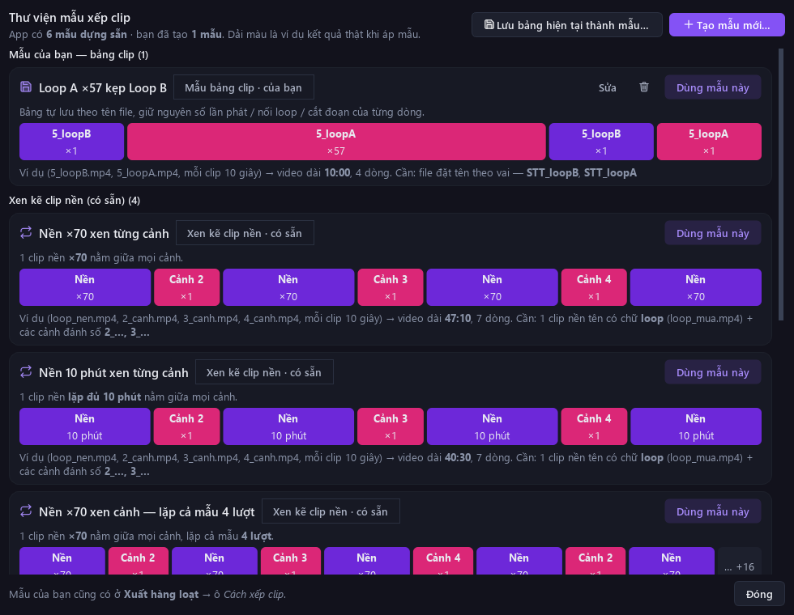
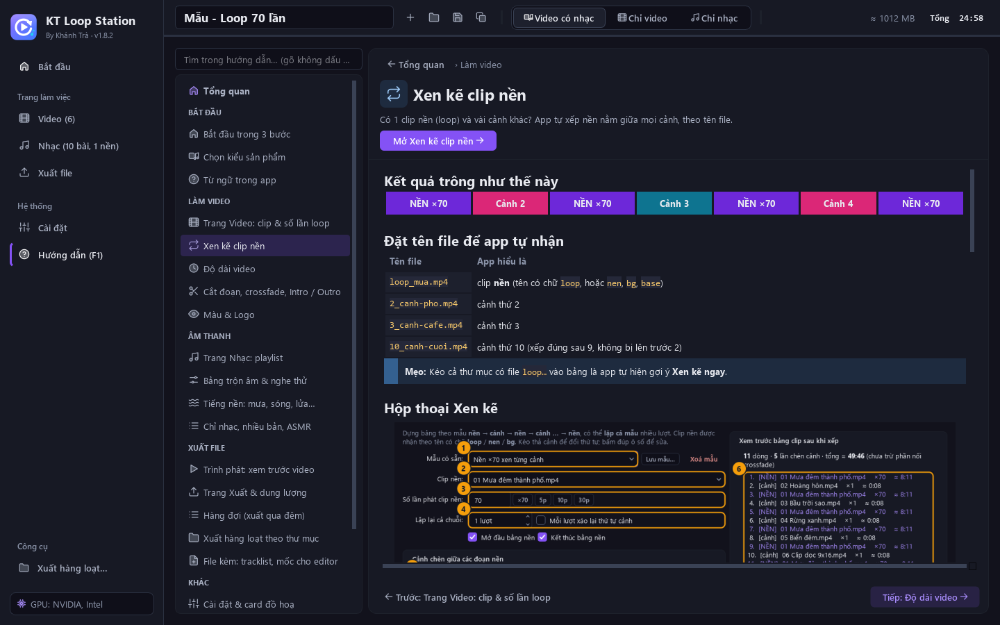
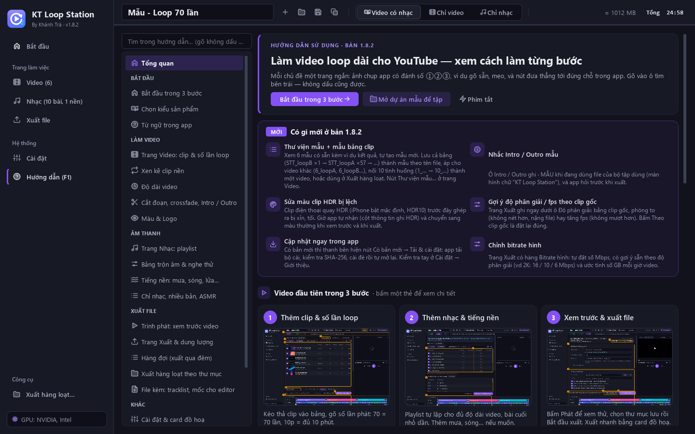
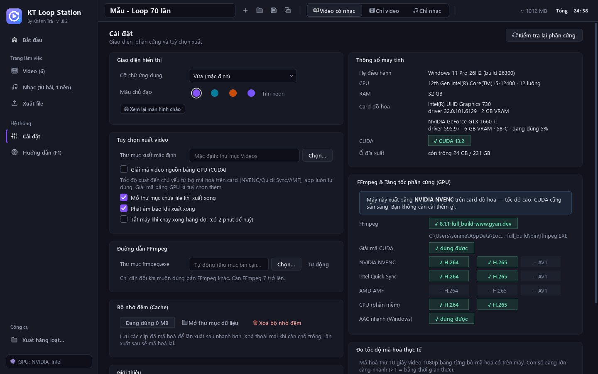

<div align="center">


# KT Loop Station

**Ghép và loop clip + nhạc thành video YouTube dài hàng giờ — xem trước ngay trong app, xuất nhanh bằng card đồ hoạ.**

<sub>By Khánh Trà · Ứng dụng Windows · Giao diện tiếng Việt · Bản mới nhất: <b>1.8.2</b></sub>

<br>

[](https://github.com/trakhanh/Auto-Loop/releases/latest)
[](https://github.com/trakhanh/Auto-Loop/releases)


<br>

<a href="https://github.com/trakhanh/Auto-Loop/releases/latest/download/KTLoopStation-Setup.exe">
  
</a>

<sub>Bấm nút để tải bộ cài · <a href="https://github.com/trakhanh/Auto-Loop/releases/latest/download/So-tay-KT-Loop-Station.html">Tải sổ tay hướng dẫn</a> · <a href="https://github.com/trakhanh/Auto-Loop/releases">Xem các phiên bản cũ</a></sub>

<br><br>


<sub>Bảng clip · cột cài đặt · <b>Trình phát</b> · <b>dòng thời gian</b> ở đáy — bố cục giống CapCut / Premiere, tự cân theo màn hình</sub>

</div>

<br>

## Có gì mới ở 1.8

<table>
<tr>
<td width="50%" valign="top">
<br>
<b>1.8.2 · Thư viện mẫu xếp clip</b><br>
Nút <b>Thư viện mẫu…</b> ở trang Video liệt kê <b>6 mẫu có sẵn</b> và các mẫu bạn tạo, mỗi mẫu có <b>dải màu ví dụ kết quả</b> (tính thật trên bộ file ví dụ) và tổng thời lượng. <b>Tạo mẫu mới…</b>: tự gõ từng dòng — vai (loopA), số lần phát (57 · 10p · 50-80), nối loop.
</td>
<td width="50%" valign="top">
<br>
<b>1.8.2 · Mẫu bảng clip theo tên STT_loopA / STT_loopB</b><br>
Lưu cả bảng (ví dụ <code>5_loopB ×1 → 5_loopA ×57 → 5_loopB ×1 → 5_loopA ×1</code>) thành mẫu, áp cho video khác (<code>6_loopA</code>, <code>6_loopB</code>…). Thư mục có <code>1_… → 10_…</code> thì <b>10 tình huống nối thành một video</b>. Dùng được ở Xuất hàng loạt. Ô Intro / Outro ghi <b>· MẪU</b> và app hỏi trước khi xuất nếu lỡ để intro mẫu.
</td>
</tr>
<tr>
<td width="50%" valign="top">
<br>
<b>1.8.1 · Sửa màu clip HDR bị lệch</b><br>
Clip quay HDR (iPhone bật mặc định, điện thoại quay HDR10, hoặc chỉnh trên CapCut / VN rồi xuất HDR) trước đây ghép ra bị <b>xỉn, tối hẳn</b>. Giờ app tự nhận ra (cột thông tin ghi <b>HDR</b>) và chuyển sang màu thường khi xem trước, khi xuất và ở ảnh thu nhỏ. Clip thường (kể cả clip AI không ghi hệ màu) vẫn giữ đúng màu như trước: đo lệch dưới 1/255.
</td>
<td width="50%" valign="top">
<br>
<b>1.8.1 · Gợi ý độ phân giải / fps theo clip gốc</b><br>
Đổi độ phân giải / fps là làm lại từng khung hình: phóng to <b>không nét hơn</b> (chỉ nặng file), tăng fps <b>không mượt hơn</b> (chỉ lặp khung). Ngay dưới ô <b>Độ phân giải</b> app ghi so với clip gốc; lệch thì bấm <b>Theo clip gốc</b>.
</td>
</tr>
<tr>
<td width="50%" valign="top">
<br>
<b>Cập nhật ngay trong app</b><br>
App tự kiểm tra bản mới khi mở. Có bản mới thì thanh bên hiện nút <b>Có bản mới</b> → <b>Tải &amp; cài đặt</b>: app tải bộ cài, kiểm tra mã <b>SHA-256</b>, tự đóng để cài đè rồi <b>tự mở lại</b>. Dự án, hàng đợi, cài đặt giữ nguyên. Kiểm tra tay ở <b>Cài đặt → Giới thiệu → Kiểm tra cập nhật</b>.
</td>
<td width="50%" valign="top">
<br>
<b>Chỉnh bitrate hình</b><br>
Trang <b>Xuất</b> có hàng <b>Bitrate hình</b>: chọn <i>Tự đặt bitrate</i> rồi gõ số Mbps. Dòng gợi ý ghi sẵn số hợp với độ phân giải đang xuất (ví dụ 2K: 16 Mbps theo YouTube · 10 vẫn đẹp · 6 nhẹ nhất) và ước tính số GB mỗi giờ video — file 2K hết nặng.
</td>
</tr>
</table>

<p align="center"></p>
<p align="center"><sub><b>Thư viện mẫu</b> — mỗi mẫu có ví dụ kết quả thật; mẫu của bạn sửa / xoá được, dùng được ở Xuất hàng loạt</sub></p>

<p align="center"></p>
<p align="center"><sub><b>Trang Xuất</b> — gợi ý độ phân giải / fps theo clip gốc, Bitrate hình (mỗi 1 Mbps ≈ 450 MB cho mỗi giờ video)</sub></p>

<br>

## Làm được gì

<table>
<tr>
<td width="33%" valign="top">
<br>
<b>Loop clip thành video dài</b><br>
Mỗi clip phát <code>70</code> lần, ngẫu nhiên <code>50-80</code>, hoặc cho đủ <code>10p</code>. Video dài đúng số giờ đặt ở 3 ô giờ · phút · giây. Cắt đoạn, hoà hình, Intro / Outro.
</td>
<td width="33%" valign="top">
<br>
<b>Tự xếp clip theo tên file</b><br>
<b>Xen kẽ clip nền</b>: <code>loop_…</code> là clip nền, <code>2_…</code>, <code>3_…</code> là cảnh → <i>nền → cảnh → nền…</i>. <b>Xếp lần lượt</b>: <i>Content → Loop1 ×60 → Loop2 ×60 …</i>
</td>
<td width="33%" valign="top">
<br>
<b>Nhạc tự lặp theo video</b><br>
Playlist lặp đủ độ dài, chuẩn hoá -14 LUFS, hoà tiếng giữa bài, ghim bài. Hoặc xuất riêng file nhạc dài, nhiều bản khác thứ tự.
</td>
</tr>
<tr>
<td valign="top">
<br>
<b>Xem trước ngay trong app</b><br>
Trình phát cho xem đúng như bản xuất — hình, nhạc, tiếng nền, hoà hình, màu &amp; logo — không phải xuất file. <kbd>Space</kbd> phát / dừng, kéo vạch dòng thời gian để tua.
</td>
<td valign="top">
<br>
<b>Tiếng nền &amp; Bảng trộn âm</b><br>
Mưa, sóng biển, gió, lửa củi, white / pink / brown noise có sẵn, lặp liền mạch. Chỉnh to / nhỏ nhạc, tiếng gốc, từng lớp nền — nghe đổi ngay. Làm được cả file ASMR 8 giờ.
</td>
<td valign="top">
<br>
<b>Xuất nhanh bằng card đồ hoạ</b><br>
NVIDIA / Intel / AMD (không có card thì dùng CPU). Video 10 giờ chỉ vài phút. Dự đoán dung lượng trước khi xuất, chỉnh được bitrate (Mbps) hoặc số GB tối đa.
</td>
</tr>
<tr>
<td valign="top">
<br>
<b>Hàng đợi qua đêm</b><br>
Xếp nhiều video rồi để máy xuất lần lượt; máy không tự ngủ, có thể tự tắt máy khi xong.
</td>
<td valign="top">
<br>
<b>Xuất hàng loạt theo thư mục</b><br>
Mỗi thư mục con thành một video / file nhạc; 3 kiểu xuất, chỉnh riêng thứ tự clip / âm lượng từng video, xem từng video ngay trong hộp thoại.
</td>
<td valign="top">
<br>
<b>File kèm cho YouTube &amp; editor</b><br>
Tracklist (dán làm Chapters), mốc thời gian đoạn LOOP / THƯỜNG (<code>.txt .csv .srt</code>, marker DaVinci <code>.edl</code>).
</td>
</tr>
</table>

<br>

## Cài đặt trong 3 bước

<table>
<tr>
<td width="33%" valign="top" align="center">
<h1>①</h1>
<b>Bấm nút “Tải về cho Windows”</b><br>
<sub>Trình duyệt tải file <code>KTLoopStation-Setup.exe</code> (~195 MB).</sub>
</td>
<td width="33%" valign="top" align="center">
<h1>②</h1>
<b>Mở file vừa tải</b><br>
<sub>Nếu hiện khung xanh <i>“Windows protected your PC”</i>: bấm <b>More info</b> → <b>Run anyway</b>.</sub>
</td>
<td width="33%" valign="top" align="center">
<h1>③</h1>
<b>Next → Install → Finish</b><br>
<sub>Mở app bằng biểu tượng <b>KT Loop Station</b> trên màn hình hoặc menu Start.</sub>
</td>
</tr>
</table>

> [!TIP]
> Không cần mật khẩu quản trị, không cần cài thêm gì (đã kèm sẵn FFmpeg). Lần đầu mở app có **màn hình chào** 3 bước; màn hình **Bắt đầu** có nút **Thử: Loop 70 lần** / **Thử: 3 tiếng** — dự án có sẵn clip, nhạc, tiếng nền để bấm Phát thử ngay.

<details>
<summary><b>Thông tin thêm</b> (yêu cầu máy, cập nhật, gỡ cài đặt, dữ liệu lưu ở đâu)</summary>

<br>

- Windows 10 / 11 64-bit. Cài vào tài khoản đang dùng, **không cần quyền quản trị**.
- Card đồ hoạ NVIDIA / Intel / AMD giúp xuất nhanh hơn nhiều; không có card thì app tự dùng CPU.
- Cảnh báo *“Windows protected your PC”* xuất hiện vì bộ cài chưa ký số — bấm **More info → Run anyway** để cài.
- **Lên bản mới**: từ bản 1.8, bấm nút **Có bản mới** ở thanh bên (hoặc **Cài đặt → Giới thiệu → Kiểm tra cập nhật**) — app tự tải, cài đè và mở lại. Bản cũ hơn: tải bộ cài mới, cài đè lên bản cũ. Dự án, hàng đợi, cài đặt luôn được giữ nguyên.
- Gỡ cài đặt: *Settings → Apps → KT Loop Station → Uninstall*.
- Dự án tự lưu, hàng đợi, bộ nhớ đệm nằm ở `%LOCALAPPDATA%\KTLoopStation` (Cài đặt → *Mở thư mục dữ liệu*).

</details>

<br>

## Dùng thế nào

| | Bước | Làm gì |
|:-:|---|---|
| **1** | **Video** | Kéo thả clip hoặc cả thư mục vào bảng, đặt **số lần phát**. Có clip `loop…` thì bấm **Xen kẽ clip nền…**; có nhiều clip Loop1, Loop2… thì bấm **Xếp lần lượt…**. Độ dài, thứ tự, Intro / Outro ở thẻ **Độ dài** bên cạnh. |
| **2** | **Nhạc &amp; Nền** | Kéo thả bài nhạc — nhạc tự lặp theo độ dài video. Thêm tiếng mưa, chỉnh **Bảng trộn âm** (có nghe thử). |
| **3** | **Xuất** | Bấm Phát ở **Trình phát** để xem thử, rồi chọn thư mục lưu → **Bắt đầu xuất**, hoặc **Thêm vào hàng đợi** để xuất nhiều video liền nhau. |

Chọn **kiểu xuất** ở thanh trên cùng: **Video có nhạc** (`.mp4`) · **Chỉ video** (`.mp4`, giữ tiếng gốc clip / thêm tiếng nền) · **Chỉ nhạc** (`.mp3 .m4a .flac .wav`). Thanh bước dưới thanh trên cùng luôn nói việc cần làm tiếp; hướng dẫn có ảnh minh hoạ từng bước nằm ngay trong app: **Hướng dẫn** ở thanh bên hoặc phím <kbd>F1</kbd>.

<p align="center"></p>
<p align="center"><sub>Mỗi chủ đề: ảnh chụp đánh số ①②③, ví dụ gõ sẵn, nút <b>Mở …</b> đưa thẳng tới chỗ làm, chuyển <b>Trước / Tiếp</b> ở cuối</sub></p>

<details>
<summary><b>Phím tắt hay dùng</b></summary>

<br>

| Phím | Tác dụng |
|---|---|
| <kbd>Space</kbd> | Phát / dừng Trình phát — ở mọi chỗ trong cửa sổ, trừ lúc đang gõ chữ vào ô |
| <kbd>←</kbd> <kbd>→</kbd> · <kbd>Home</kbd> | Tua 5 giây · về đầu (bấm vào khung hình trước) |
| Nhấp đúp vào hình · <kbd>Esc</kbd> | Xem toàn màn hình · thoát |
| <kbd>Ctrl</kbd>+<kbd>C</kbd> / <kbd>Ctrl</kbd>+<kbd>V</kbd> / <kbd>Ctrl</kbd>+<kbd>D</kbd> | Chép / dán / nhân bản dòng (bảng clip và playlist) |
| <kbd>Ctrl</kbd>+<kbd>Space</kbd> · <kbd>Delete</kbd> | Bật / tắt dòng · xoá dòng |
| <kbd>Ctrl</kbd>+<kbd>Z</kbd> · <kbd>Ctrl</kbd>+<kbd>S</kbd> · <kbd>F1</kbd> | Hoàn tác · lưu dự án · mở Hướng dẫn |
| <kbd>Ctrl</kbd>+<kbd>F</kbd> | Tìm tên file trong bảng · tìm trong Hướng dẫn (gõ không dấu cũng được) |
| <kbd>↑</kbd> <kbd>↓</kbd> · <kbd>Tab</kbd> | Trong ô giờ / phút / giây: tăng / giảm 1 · sang ô kế tiếp |

</details>

> [!TIP]
> Cần tài liệu đầy đủ để gửi hoặc in cho nhân viên? Tải **[Sổ tay KT Loop Station](https://github.com/trakhanh/Auto-Loop/releases/latest/download/So-tay-KT-Loop-Station.html)** — một file, mở bằng trình duyệt (Chrome / Edge), có ảnh chụp đánh số: cài đặt, trình phát, làm video loop có nhạc, xếp lần lượt, chỉ nhạc, xuất hàng loạt, từ ngữ trong app, xử lý sự cố. Muốn in hoặc lưu PDF: mở file rồi bấm `Ctrl+P`.

<br>

## Ảnh màn hình

<table>
<tr>
<td width="50%"><p align="center"><sub><b>Màn hình Bắt đầu</b> — chọn việc muốn làm</sub></p></td>
<td width="50%"><p align="center"><sub><b>Trang Nhạc</b> — playlist, Bảng trộn âm, tiếng nền</sub></p></td>
</tr>
<tr>
<td><p align="center"><sub><b>Hướng dẫn (F1)</b> — Tổng quan: có gì mới, 3 bước, mọi chủ đề</sub></p></td>
<td><p align="center"><sub><b>Cài đặt</b> — 2 cột: giao diện &amp; tuỳ chọn · phần cứng &amp; card đồ hoạ</sub></p></td>
</tr>
<tr>
<td><p align="center"><sub><b>Xuất hàng loạt</b> — 3 kiểu xuất, mỗi thư mục con một video, trình phát nhúng</sub></p></td>
<td><p align="center"><sub><b>Màn hình chào</b> — lần đầu mở app</sub></p></td>
</tr>
<tr>
<td colspan="2" align="center"><p align="center"><sub><b>Xếp lần lượt</b> — Content → Loop1 ×60 → Loop2 ×60 → …</sub></p></td>
</tr>
</table>

<details>
<summary><b>Các bản trước</b> (1.7 · 1.6 · 1.5)</summary>

<br>

- **1.7** — giao diện mới gọn và phẳng, bố cục tự cân (không còn ô bị cắt mép, Cài đặt chia 2 cột), Hướng dẫn (F1) có trang Tổng quan, đọc file chạy nền, sửa ô giờ / phút / giây không gõ được.
- **1.6** — chọn được màu chủ đạo, màn hình chào lần đầu, bảng quy chuẩn khoảng cách / cỡ chữ dùng chung mọi trang.
- **1.5** — Trình phát ngay trong app (xem thử không phải xuất), bố cục kiểu CapCut / Premiere, **Xếp lần lượt** (Content → Loop1 ×60 → …), Xuất hàng loạt có 3 kiểu xuất và trình phát nhúng, chung một bộ từ ngữ ở mọi trang, <kbd>Ctrl</kbd>+<kbd>C</kbd> / <kbd>V</kbd> / <kbd>D</kbd> cho bảng clip và playlist.

Ghi chú đầy đủ từng bản ở trang [Releases](https://github.com/trakhanh/Auto-Loop/releases).

</details>

<br>

<details>
<summary><b>Dành cho người phát triển</b> (chạy từ mã nguồn, kiểm thử, cấu trúc)</summary>

### Chạy từ mã nguồn

Cần **Python 3.12+** và **FFmpeg 7+** (đặt `ffmpeg.exe`, `ffprobe.exe` trong `PATH` hoặc trong thư mục `bin\` cạnh `app.py`).

Bấm đúp `run.bat` (lần đầu tự tạo `.venv` và cài PySide6), hoặc:

```bash
python -m venv .venv
.venv\Scripts\python.exe -m pip install -r requirements.txt
.venv\Scripts\python.exe app.py
```

### Kiểm thử

```bash
python -m pytest -q tests
```

Các script khác (đều dùng thư mục dữ liệu riêng, không đụng dữ liệu thật). Nên chạy bằng cả Python hệ thống và `.venv\Scripts\python.exe` — hai bản PySide6 khác nhau có thể vẽ giao diện khác nhau (ví dụ PySide6 6.12 từng làm hỏng ô giờ / phút / giây).

| Lệnh | Việc |
|---|---|
| `python tests/render_check.py <thư_mục>` | Xuất thật 14 kịch bản rồi kiểm tra bằng ffprobe |
| `python tests/ui_smoke.py <thư_mục>` | Chạy khắp giao diện (không hiện cửa sổ), bắt lỗi ngầm |
| `python tests/clickable_check.py <thư_mục>` | Mọi nút / ô trên các trang và hộp thoại: đủ lớn, gõ được, không bị che, không bị cắt |
| `python tests/preview_check.py <thư_mục>` | Trình phát: đồng bộ hình / tiếng, tua, dừng, sửa dự án khi đang xem |
| `python tests/player_audit_check.py <thư_mục>` | Trình phát: không tiếng, hết video, bộ nhớ đệm, nhấp đúp |
| `python tests/keys_check.py <thư_mục>` | Phím Space / Ctrl+Space ở mọi chỗ |
| `python tests/sequence_check.py <thư_mục>` | Xếp lần lượt, fps theo clip chính, Ctrl+C / V / D |
| `python tests/batch_kinds_check.py <thư_mục>` · `batch_volume_check.py` | Xuất hàng loạt: 3 kiểu, độ dài, âm lượng, trình phát |
| `python tests/help_check.py <thư_mục>` · `input_check.py` | Trang Hướng dẫn · ô nhập giờ / phút / giây |
| `python tests/look_check.py <thư_mục>` | Màu chủ đạo, chuyển trang, màn hình chào |
| `python tests/make_help_images.py` · `make_screenshots.py` · `make_readme_icons.py` | Ảnh cho Hướng dẫn / README |
| `python tests/make_test_pack.py` · `make_samples.py` | Tạo lại media mẫu `Mau-Test/`, `samples/` |

### Cấu trúc

```
app.py                  khởi động (màn hình chờ, chỉ mở 1 cửa sổ, ghi lỗi bất ngờ)
loopstation/core/       xử lý: lập kế hoạch phát, dựng khối video / âm thanh, xuất, hàng đợi, hàng loạt,
                        bộ máy xem trước (preview_engine: dựng khung hình thô, không mã hoá)
loopstation/ui/         giao diện PySide6 (các trang, Trình phát, Bảng trộn âm, hộp thoại);
                        theme.py = token màu + QSS, help_page.py + help_hub.py = Hướng dẫn
tests/                  kiểm thử + script kiểm tra / tạo ảnh / tạo mẫu
Mau-Test/, samples/     media mẫu do script tự tạo (đi kèm bộ cài)
docs/                   ảnh README, sổ tay nhân viên (So-tay-KT-Loop-Station.html)
SPEC.md                 đặc tả chi tiết
```

</details>

<br>

<div align="center">
<sub>Mã nguồn © Khánh Trà · Bộ cài kèm <b>FFmpeg</b> (bản dựng gyan.dev, giấy phép GPL v3 — xem <code>bin\FFmpeg-LICENSE.txt</code> sau khi cài)</sub>
</div>
